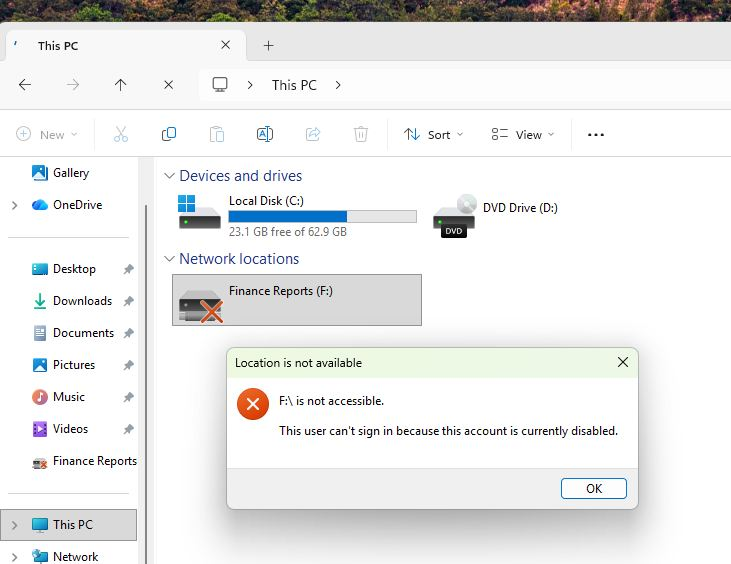
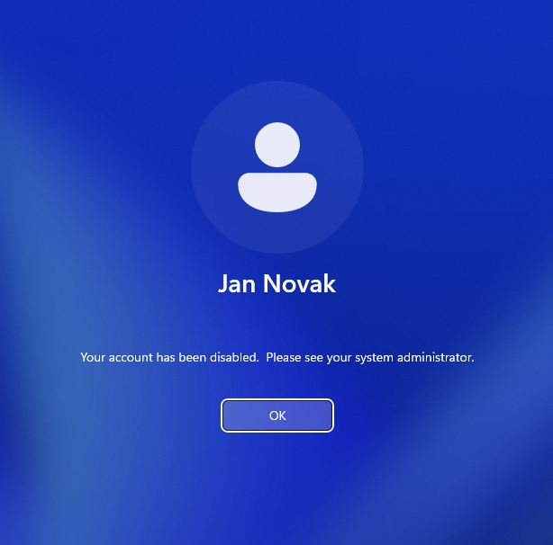
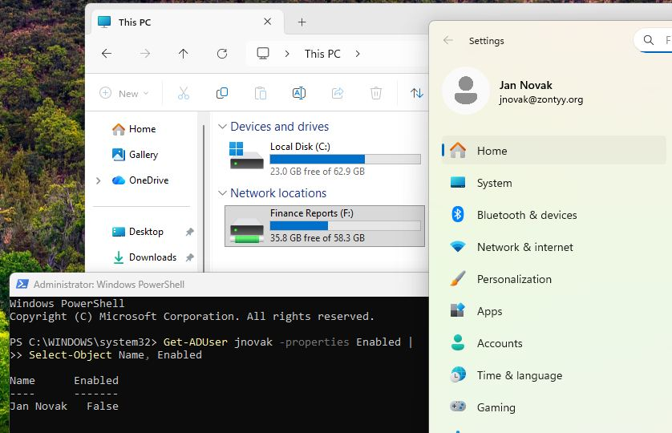

# 1. AD -> Client behavior

## User signed out before the account was disabled

When the user is signed out before his domain account gets disabled, Windows will usually allow to still log in using the **cached credentials**.

However this really isn't a big deal, because after logging in the user would essentially be locked out anyway. I tried accessing the shared folder using the cached credentials and was unable to do so.


Also, after signing in using the cached credentials, the user would soon be notified by Windows to sign out and back in using the current credentials and that would cause him to be locked out completely.


## User sign in when the account gets disabled

This is a bit worse. When the user is signed in when his account gets disabled on the Server, the user still maintains his rights. I am able to access the shared folder, even tho my account is supposed to be disabled.


So best thing to do here, is to find the user's active session and terminate it. Then change his password (even if the account is disabled already), and revoke all sessions on Entra ID.

If we know the workstation the user is logged into, we can use the command:  
`quser /server:<CLIENT_NAME>`  
and then:  
`logoff <SESSION_ID> /server:<CLIENT_NAME>`  

If we don't know the session name, we can make a script that searches all domain-joined workstations and finds the active session with the given account name.

For example:

```powershell
# User to search for (SAM account name)
$Username = ""

$Computers = Get-ADComputer -Filter 'Enabled -eq $true' |
    Select-Object -ExpandProperty Name

foreach ($Computer in $Computers) {
    try {
        $Sessions = quser /server:$Computer 2>$null

        if ($Sessions -match [regex]::Escape($Username)) {
            Write-Host "`nFound $Username on $Computer" -ForegroundColor Green
            $Sessions | Select-String ([regex]::Escape($Username))
        }
    }
    catch {
        # Computer unavailable or remote session query failed
    }
}
```

Then again find the **session ID** and **client name** run the command to log the user off.

## Recap

| Situation          | Result                                                                                                                                        | Action to take                                                  |
| ------------------ | --------------------------------------------------------------------------------------------------------------------------------------------- | --------------------------------------------------------------- |
| User logged in     | Session remains active and valid                                                                                                              | Force the user to log off and take the necessary security steps |
| User not logged in | Cached credentials might be used; Session will be invalid though, user will be required to relog and won't be able to access domain materials |

# 2. AD -> Entra ID behavior

## User logged in and active in browser

The current session will typically remain active. This is because cookies and refresh token might be keeping the session alive.

However the session usually terminates immediatelly after the user gets redirected, or tries to access something else on the website, then the session refreshes and the user gets signed out, unable to log back in.

## User signed out before their account gets disabled

When the user is NOT signed in, the account will be inaccessible during the next log in attempt. There's no cached credentials here.

## Recap

| Scenario               | Result                                                                    |
| ---------------------- | ------------------------------------------------------------------------- |
| User signed in before  | Current session will remain active, until the app needs to reauthenticate |
| User signed out before | All new sessions will be blocked                                          |
